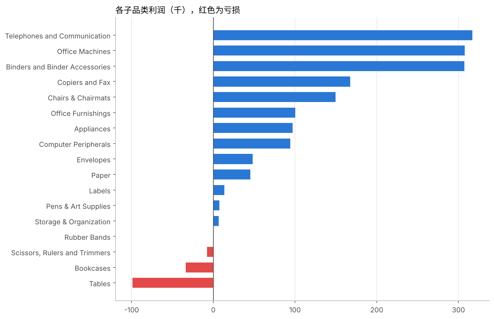
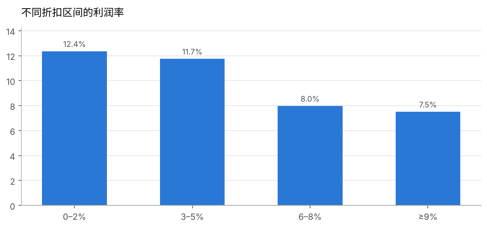

# 零售企业销售数据分析

> 用 Python 对一家零售企业 4 年、8,399 条订单数据做清洗和分析，找出“哪里赚钱、哪里亏钱”，并给出可落地的经营建议。

**完整分析过程**：[sales_analysis.ipynb](sales_analysis.ipynb)（GitHub 上可直接查看代码、图表和结论）

## 核心发现

| 发现 | 数据 |
|---|---|
| 超过一半的订单在亏钱 | 亏损订单占比 50.8%，整体利润率 10.2% |
| 家具品类是最大的利润漏洞 | 销售额占 35%，利润率仅 2.3%；桌子 + 书柜合计亏损 13.3 万 |
| 折扣越高，利润越薄 | 折扣 0–2% 时利润率 12.4%，≥9% 时降到 7.5% |
| 最大区域利润率偏低 | West 区销售额第一（360 万），利润率仅 8.3% |
| 增长停滞 | 2012 年销售额比 2009 年低约 12%，利润率为 4 年最低 |





## 分析流程

1. **数据清洗**：处理老式换行符和编码问题，删除空行，按子品类中位数填补 63 条缺失的毛利率，修正区域名拼写错误，转换日期并计算发货天数
2. **经营概况**：KPI 汇总，年度和月度趋势
3. **品类分析**：品类和子品类的销售额、利润、利润率，定位亏损来源
4. **折扣分析**：分档对比利润率和亏损订单占比
5. **区域分析**：规模和利润率两个维度对比
6. **客户分析**：帕累托曲线和客户分群
7. **结论与建议**：每条建议对应数据依据和影响估算

## 技术栈

Python · Pandas · NumPy · Matplotlib · Jupyter Notebook

## 如何运行

```bash
pip install pandas numpy matplotlib jupyter
jupyter notebook sales_analysis.ipynb
```

## 数据来源

Superstore Sales 公开数据集（加拿大办公用品零售商，2009–2012），来自 [curran/data](https://github.com/curran/data/tree/gh-pages/superstoreSales)。
