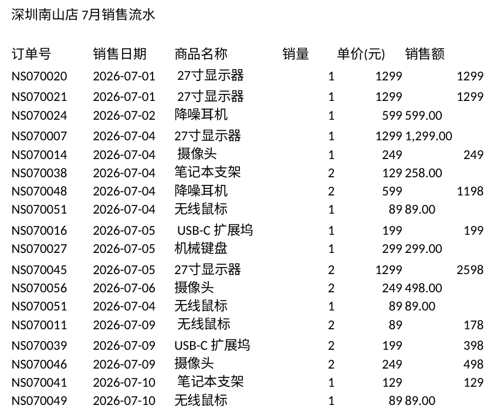
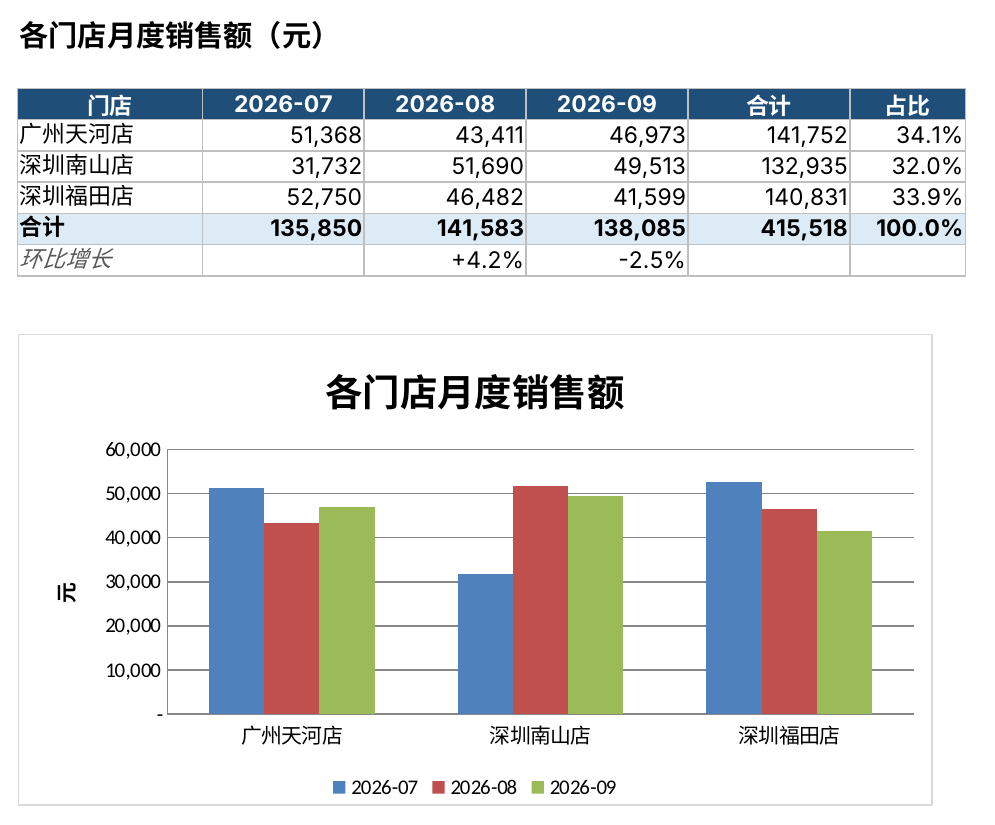

# 多门店 Excel 报表一键合并汇总

> 每月要把各门店交上来的 Excel 手工复制粘贴、对格式、算合计？这个脚本把 **9 个格式混乱的报表** 在几秒内清洗合并，输出一份带公式、带图表的汇总表。

## 效果

**处理前**：各门店的原始流水（标题行、列名不统一、文本金额、多余空格、重复录入……）



**处理后**：自动生成的汇总表（所有汇总数字都是 Excel 公式，改明细会自动更新）



## 自动处理的问题

| 原始数据中的问题 | 脚本的处理 | 本例数量 |
|---|---|---|
| 表头上方有标题行、空行 | 自动识别真正的表头行 | 9 个文件 |
| 各门店列名不一致（日期 / 销售日期，商品 / 品名……） | 按别名映射统一成标准列名 | 3 套列名 |
| 日期格式混杂（2026/7/3、2026-07-03、Excel 日期） | 统一转成日期类型 | — |
| 金额是带逗号的文本（“1,299.00”） | 转成数字 | — |
| 商品名前后有空格 | 去除空格，避免同一商品被算成两个 | — |
| 空行 | 删除 | 18 行 |
| 手工“合计”行 | 删除，避免重复计算 | 9 行 |
| 同一单号重复录入 | 按单号去重 | 27 行 |
| 金额 ≠ 数量 × 单价 | 按数量 × 单价修正，并记录在日志里 | 9 行 |

**一个关键细节**：去重按单号，而不是按整行内容。同一天卖出两笔“同款、同数量”的订单是真实存在的，按整行去重会把它们误删，汇总金额就错了。

## 输出文件包含 4 个工作表

| 工作表 | 内容 |
|---|---|
| 门店月度汇总 | 门店 × 月份的销售额矩阵、合计、占比、环比增长，以及柱状图 |
| 商品排行 | 各商品的销量、销售额和占比，按销售额排序 |
| 明细 | 清洗后的全部记录，已冻结表头、开启筛选 |
| 清洗日志 | 每个文件删了什么、改了什么，方便核对 |

## 使用方法

```bash
pip install pandas openpyxl

# 1. 生成演示数据（用自己的数据时跳过这一步）
python make_sample_data.py

# 2. 合并汇总
python merge_reports.py
# 或指定文件夹和输出文件
python merge_reports.py -i 你的报表文件夹 -o 结果.xlsx
```

文件名格式：`门店名_2026年7月.xlsx`。列名只要在脚本的 `COLUMN_ALIASES` 里有对应别名就能识别，遇到新的叫法加一个别名即可。

## 文件说明

```
make_sample_data.py   生成 9 个模拟的混乱门店报表（演示用）
merge_reports.py      清洗 + 合并 + 输出汇总表（核心脚本）
input/                原始报表
output/销售汇总.xlsx   输出结果
```

## 技术栈

Python · Pandas（清洗与合并）· openpyxl（公式、样式、图表）
